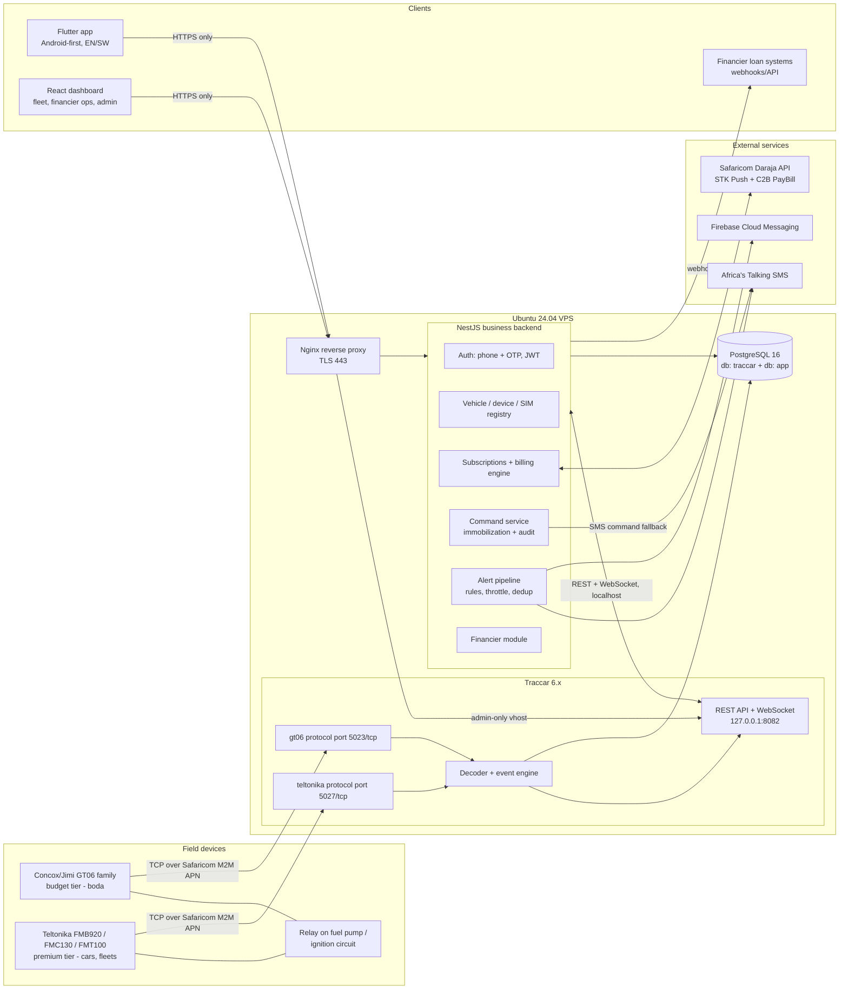
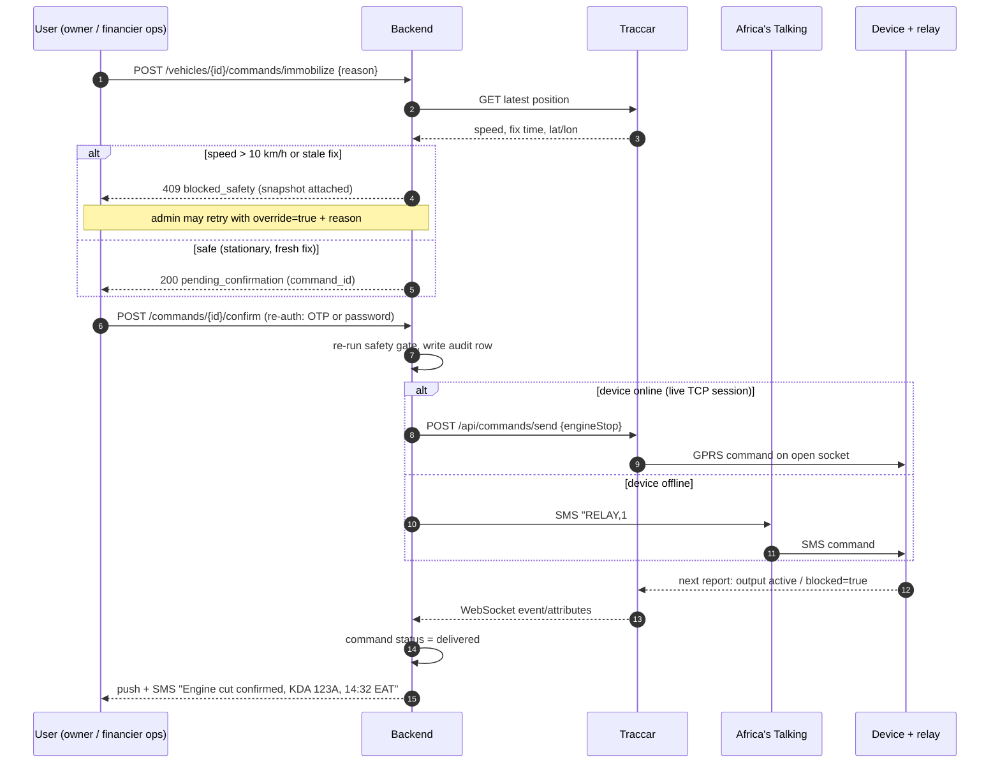
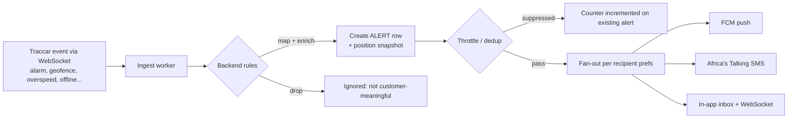
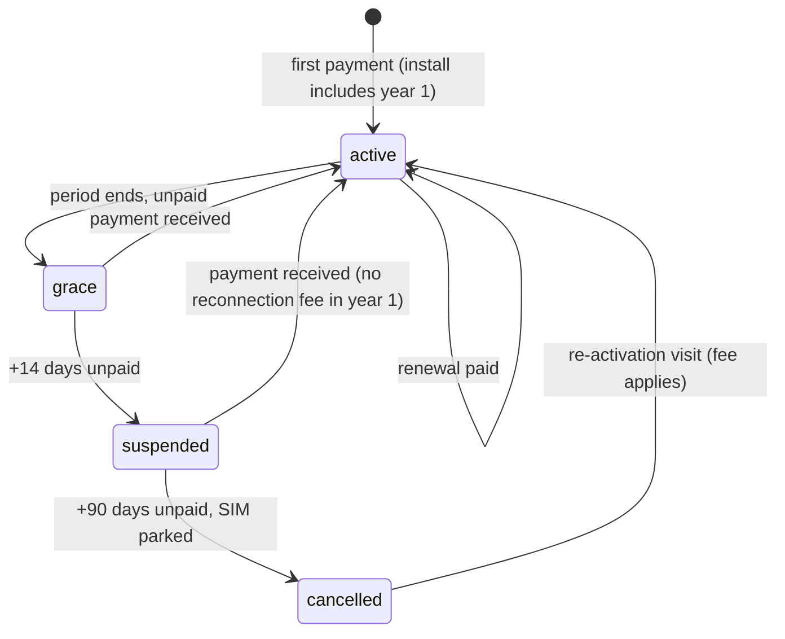

# 01 — Technical Specification
## Kenya Vehicle & Motorbike Tracking Platform

**Version:** 1.0 · **Date:** 2026-07-06 · **Status:** Approved architecture (Path B: open-source core + custom layer)

---

## 1. System overview

The platform is a GPS tracking product for cars and motorbikes in Kenya, serving individual owners, boda boda riders, fleets, and — as the volume B2B segment — asset financiers, SACCOs, and insurers.

It is built as two cooperating systems on one Ubuntu 24.04 VPS (initially):

1. **Traccar** (self-hosted, Apache 2.0) — the tracking engine. It terminates device connections on protocol ports, decodes GT06/Teltonika (and 200+ other) protocols, stores positions, computes low-level events (geofence in/out, overspeed, power cut, ignition), and exposes a REST API + WebSocket.
2. **Business backend** (Node.js + TypeScript, NestJS) — everything commercial and Kenya-specific: accounts and phone+OTP auth, organizations and roles, vehicle/device/SIM registries, subscriptions and renewals, M-Pesa (Daraja) payments, SMS/push notifications via Africa's Talking and FCM, immobilization with audit trail and safety policy, and the financier module.

**End users never talk to Traccar directly.** The Flutter app and React dashboard talk only to the backend; the backend consumes Traccar's REST API and WebSocket on localhost. Traccar's own web UI stays reachable only to internal admins over the reverse proxy (separate hostname, IP-allowlisted).

### 1.1 Architecture diagram

---

## 2. Component responsibilities

### 2.1 What stays inside Traccar

| Concern | Detail |
|---|---|
| Protocol termination | TCP listeners per protocol; **gt06 = port 5023**, **teltonika = port 5027** (verified against traccar.org/devices — see §13) |
| Decoding | Frame parsing, IMEI identification, position/attribute extraction (speed, course, ignition, power voltage, GSM signal, alarm flags) |
| Position storage | `tc_positions` table in the `traccar` database |
| Low-level events | `deviceOnline/Offline`, `geofenceEnter/Exit`, `deviceOverspeed`, `ignitionOn/Off`, `alarm` (powerCut, lowBattery, jamming, tamper, sos, vibration) |
| Geofence geometry | Circle/polygon/polyline storage and hit-testing (backend mirrors metadata, delegates geometry) |
| GPRS command delivery | `engineStop` / `engineResume` / custom payloads pushed down the live TCP session |
| Device session state | Which device is connected, last communication time |

### 2.2 What the business backend owns

| Concern | Detail |
|---|---|
| Identity & auth | Phone+OTP login, JWT access/refresh tokens, sessions, device binding |
| Organizations & roles | Personal, fleet, SACCO, financier org types; RBAC (owner, admin, manager, viewer, installer, recovery_agent, financier_ops) |
| Registries | Vehicles ↔ devices ↔ SIM cards; provisioning state machine; installer jobs |
| Commercial | Plans, subscriptions, invoices, payments, STK Push, C2B reconciliation, receipts, dunning |
| Immobilization policy | Two-step confirmation, speed/stationary safety gate, override rules, full audit, SMS fallback path |
| Alert semantics | Mapping raw Traccar events to customer-meaningful alerts, per-user channel preferences, throttling/dedup, quiet hours |
| Financier module | Loan links, payment-status flags, batch operations, portfolio dashboards, recovery links, LMS webhooks |
| Notifications | FCM push, Africa's Talking SMS, in-app inbox; delivery tracking and SMS cost accounting |
| Compliance | Consent records, ODPC-aligned retention jobs, data subject requests |

**Integration rule:** the backend is the *only* Traccar API client. It authenticates to Traccar with a service account token, mirrors devices/geofences into Traccar (backend is source of truth), subscribes to `/api/socket` for live positions/events, and re-publishes them to clients over its own WebSocket/SSE channel scoped by RBAC.

---

## 3. Data model

Two logical databases on one PostgreSQL instance: `traccar` (owned by Traccar, we treat it read-only except via API) and `app` (backend). The backend stores `traccar_device_id` / `traccar_geofence_id` foreign references, never joins across databases at runtime (API-mediated).

```mermaid
erDiagram
    USERS ||--o{ ORG_MEMBERS : "belongs to"
    ORGANIZATIONS ||--o{ ORG_MEMBERS : "has"
    ORGANIZATIONS ||--o{ VEHICLES : owns
    USERS ||--o{ VEHICLES : "owns (personal)"
    VEHICLES ||--o| DEVICES : "fitted with"
    DEVICES ||--o| SIM_CARDS : uses
    VEHICLES ||--o{ SUBSCRIPTIONS : "billed via"
    SUBSCRIPTIONS ||--o{ INVOICES : generates
    INVOICES ||--o{ PAYMENTS : "settled by"
    VEHICLES ||--o{ COMMANDS : receives
    USERS ||--o{ COMMANDS : initiates
    VEHICLES ||--o{ ALERTS : raises
    ALERTS ||--o{ NOTIFICATION_DELIVERIES : "fans out to"
    ORGANIZATIONS ||--o{ GEOFENCES : defines
    VEHICLES }o--o{ GEOFENCES : "monitored by"
    ORGANIZATIONS ||--o{ LOANS : "finances (financier orgs)"
    LOANS ||--|| VEHICLES : "collateral"
    VEHICLES ||--o{ INSTALLER_JOBS : "worked on"
    USERS ||--o{ INSTALLER_JOBS : "assigned to"
    VEHICLES ||--o{ RECOVERY_LINKS : "shared via"

    USERS {
        uuid id PK
        varchar phone "2547XXXXXXXX, unique"
        varchar full_name
        varchar email "nullable"
        varchar locale "en | sw"
        varchar status "active | suspended"
        timestamptz consent_accepted_at "ODPC consent record"
        timestamptz created_at
    }
    ORGANIZATIONS {
        uuid id PK
        varchar name
        varchar type "personal | fleet | sacco | financier | insurer"
        varchar kra_pin "nullable"
        jsonb immobilization_policy "financier default-flag rules"
        timestamptz created_at
    }
    ORG_MEMBERS {
        uuid org_id FK
        uuid user_id FK
        varchar role "owner | admin | manager | viewer | installer | recovery_agent | financier_ops"
    }
    VEHICLES {
        uuid id PK
        uuid org_id FK "nullable for personal"
        uuid owner_user_id FK "nullable for org-owned"
        varchar reg_plate "e.g. KDA 123A, unique"
        varchar type "car | motorbike | tuktuk | truck"
        varchar make_model
        uuid device_id FK
        uuid loan_id FK "nullable"
        varchar status "active | immobilized | suspended | in_recovery"
    }
    DEVICES {
        uuid id PK
        varchar imei "unique, 15 digits"
        varchar model "GT06N | FMB920 | FMC130 | FMT100 ..."
        varchar protocol "gt06 | teltonika"
        bigint traccar_device_id "FK into Traccar via API"
        uuid sim_card_id FK
        boolean relay_fitted
        varchar status "in_stock | provisioning | installed | faulty | retired"
        varchar firmware_version
    }
    SIM_CARDS {
        uuid id PK
        varchar iccid "unique"
        varchar msisdn "2547XXXXXXXX"
        varchar provider "safaricom_m2m"
        varchar apn "safaricom"
        date bundle_expiry
        int data_mb_month
        varchar status "in_stock | active | dormant | blocked"
        timestamptz last_data_check_at
    }
    SUBSCRIPTIONS {
        uuid id PK
        uuid vehicle_id FK
        varchar plan_code "boda_std | car_std | car_premium | fleet | financier"
        varchar status "active | grace | suspended | cancelled"
        date current_period_start
        date current_period_end
        int renewal_price_ksh
        boolean auto_stk_enabled
    }
    INVOICES {
        uuid id PK
        uuid subscription_id FK
        varchar account_ref "PayBill account no., unique, printed on receipts"
        int amount_ksh
        date due_date
        varchar status "pending | paid | overdue | void"
    }
    PAYMENTS {
        uuid id PK
        uuid invoice_id FK "nullable until matched"
        varchar method "stk_push | c2b_paybill | manual"
        varchar mpesa_receipt "e.g. SGH3XK91QT, unique"
        varchar payer_phone "2547XXXXXXXX"
        int amount_ksh
        varchar status "pending | confirmed | failed | unmatched | refunded"
        varchar matched_by "account_ref | phone | manual | null"
        jsonb raw_callback "full Daraja payload, immutable"
        timestamptz mpesa_time
    }
    COMMANDS {
        uuid id PK
        uuid vehicle_id FK
        uuid device_id FK
        varchar type "engine_cut | engine_restore | reboot | request_position"
        uuid initiated_by FK "user"
        uuid confirmed_by FK "user, two-step"
        varchar channel "gprs | sms_fallback"
        varchar status "pending_confirmation | blocked_safety | queued | sent | delivered | failed | cancelled | expired"
        boolean safety_override
        varchar reason "free text, mandatory for engine_cut"
        jsonb position_snapshot "speed/lat/lon at decision time"
        timestamptz confirmed_at
        timestamptz delivered_at
    }
    ALERTS {
        uuid id PK
        uuid vehicle_id FK
        varchar type "power_cut | jamming | overspeed | geofence_in | geofence_out | ignition_on | ignition_off | low_battery | tamper | offline | restricted_hours | sos"
        varchar severity "info | warning | critical"
        bigint traccar_event_id
        jsonb position_snapshot "last-known lat/lon/speed/time"
        varchar dedup_key "type+vehicle+bucket"
        varchar status "new | acknowledged | resolved"
        timestamptz created_at
    }
    NOTIFICATION_DELIVERIES {
        uuid id PK
        uuid alert_id FK
        uuid user_id FK
        varchar channel "push | sms | in_app"
        varchar status "queued | sent | delivered | failed"
        int cost_cents "SMS cost accounting"
    }
    GEOFENCES {
        uuid id PK
        uuid org_id FK
        varchar name
        text area_wkt "CIRCLE or POLYGON, mirrored to Traccar"
        bigint traccar_geofence_id
        boolean alert_on_enter
        boolean alert_on_exit
        jsonb schedule "e.g. restricted hours 21:00-05:00 EAT"
    }
    LOANS {
        uuid id PK
        uuid financier_org_id FK
        uuid vehicle_id FK
        uuid borrower_user_id FK
        varchar external_ref "loan ID in financier LMS"
        varchar repayment_status "current | arrears | default"
        int days_in_arrears
        date next_due_date
        varchar immobilization_flag "none | flagged | confirmed | immobilized"
        timestamptz flag_updated_at
    }
    INSTALLER_JOBS {
        uuid id PK
        uuid vehicle_id FK
        uuid installer_user_id FK
        varchar type "install | relay_retrofit | repair | removal | inspection"
        varchar status "scheduled | in_progress | done | failed"
        timestamptz scheduled_at
        jsonb completion_evidence "photos, geotag, tested_ok"
        int payout_ksh
    }
    RECOVERY_LINKS {
        uuid id PK
        uuid vehicle_id FK
        uuid created_by FK
        varchar token "unguessable, in URL"
        timestamptz expires_at "default 72h"
        varchar status "active | revoked | expired"
    }
```

**Retention & partitioning note:** Traccar's `tc_positions` is the fast-growing table. Partition by month (native PostgreSQL partitioning) once volume exceeds ~1M rows/day; retain raw positions ≥ 12 months (ODPC-documented, configurable per contract), then archive to compressed cold storage before deletion. All backend audit tables (`commands`, `payments`) are append-only and retained 7 years.

---

## 4. API design

Base URL: `https://api.<domain>/v1`. Auth: `Authorization: Bearer <JWT>` except the OTP endpoints and Daraja/AT callbacks (which are verified by source + shared secret instead). All list endpoints paginate (`?page=&limit=`); all times UTC ISO-8601; phones always `2547XXXXXXXX`.

### 4.1 Endpoint map and Traccar mapping

| Area | Endpoint | Method | Purpose | Maps to Traccar |
|---|---|---|---|---|
| Auth | `/auth/otp/request` | POST | Send 6-digit OTP via Africa's Talking to `phone` | — |
| Auth | `/auth/otp/verify` | POST | Verify OTP → issue JWT access (15 min) + refresh (30 d) | — |
| Auth | `/auth/refresh` | POST | Rotate refresh token | — |
| Vehicles | `/vehicles` | GET/POST | List/register vehicles for caller's scope | POST also creates Traccar device: `POST /api/devices {name, uniqueId: imei}` |
| Vehicles | `/vehicles/{id}` | GET/PATCH/DELETE | Detail, edit, decommission | DELETE disables Traccar device |
| Live | `/vehicles/{id}/position` | GET | Latest position + engine/speed/battery | `GET /api/positions?deviceId=` |
| Live | `/stream` (WebSocket) | WS | Live positions + alerts for caller's vehicles | Backend's single upstream `GET /api/socket`, fanned out with RBAC filtering |
| History | `/vehicles/{id}/trips?from&to` | GET | Trip list (start/stop, distance, max speed) | `GET /api/reports/trips` |
| History | `/vehicles/{id}/route?from&to` | GET | Raw playback polyline (thinned server-side for low-data mode) | `GET /api/positions?deviceId&from&to` |
| Reports | `/vehicles/{id}/reports/daily?date` | GET | Daily mileage + fuel-from-mileage estimate | `GET /api/reports/summary` + backend fuel model |
| Geofences | `/geofences` | GET/POST | CRUD geofences; schedule attribute for restricted hours | Mirrors to `POST /api/geofences` + `POST /api/permissions` (device↔geofence link) |
| Commands | `/vehicles/{id}/commands/immobilize` | POST | **Step 1:** request engine cut → `pending_confirmation`, returns `command_id` + safety verdict | — (nothing sent yet) |
| Commands | `/commands/{id}/confirm` | POST | **Step 2:** second confirmation (re-auth) → queue & send | `POST /api/commands/send {type: engineStop}` |
| Commands | `/vehicles/{id}/commands/restore` | POST | Engine restore (single-step, still audited) | `POST /api/commands/send {type: engineResume}` |
| Commands | `/commands/{id}` | GET | Status + audit detail | Delivery status via Traccar event/position attributes |
| Alerts | `/alerts?status&type&from` | GET | Alert inbox | Backend table (sourced from Traccar events) |
| Alerts | `/alerts/{id}/ack` | POST | Acknowledge | — |
| Prefs | `/me/notification-prefs` | GET/PUT | Per-type channel matrix (push/SMS/off), quiet hours | — |
| Billing | `/billing/subscriptions` | GET | My subscriptions + states | — |
| Billing | `/billing/invoices/{id}/stk` | POST | Fire STK Push for invoice to caller's phone | — (Daraja `mpesa/stkpush/v1/processrequest`) |
| Billing | `/webhooks/daraja/stk` | POST | STK result callback (public, validated) | — |
| Billing | `/webhooks/daraja/c2b` | POST | C2B confirmation callback (public, validated) | — |
| Financier | `/financier/portfolio` | GET | Units, online %, arrears buckets, immobilized count | Aggregates backend + Traccar last-position |
| Financier | `/financier/loans` | GET/POST | Link loans↔vehicles, set repayment status (or via webhook) | — |
| Financier | `/financier/loans/import` | POST | CSV/JSON batch upsert of repayment statuses | — |
| Financier | `/financier/batch/flag` | POST | Auto-flag defaulters per policy → creates `pending_confirmation` commands, **never auto-sends** | — |
| Financier | `/financier/batch/confirm` | POST | Human ops confirms a reviewed flag list (each item individually safety-checked) | `POST /api/commands/send` per unit |
| Financier | `/vehicles/{id}/recovery-link` | POST | Create expiring public live-location link | Public page polls backend, backend polls Traccar |
| Financier | `/financier/webhooks` | GET/POST | Register LMS endpoints (loan.updated, vehicle.immobilized, vehicle.recovered, payment.received) | — |
| Admin | `/admin/sims`, `/admin/devices`, `/admin/installer-jobs` | GET/POST/PATCH | Ops registries (see §8) | Device create/disable mirrored |

### 4.2 Conventions

- **Errors:** RFC 7807 problem+json (`{type, title, status, detail, traceId}`).
- **Idempotency:** mutating billing/command endpoints accept `Idempotency-Key` header; Daraja callbacks deduped by `CheckoutRequestID` / `TransID`.
- **Rate limits:** OTP request 3/phone/10 min; command endpoints 10/user/hour; global 100 req/min/token.
- **Low-data mode:** clients send `X-Data-Saver: 1`; route responses are Douglas-Peucker-thinned and gzip is mandatory.

---

## 5. Immobilization flow

Engine cut-off is the highest-liability feature. Policy:

1. **Two-step confirmation** — a cut is *requested* by one action and *confirmed* by a second explicit action (re-entering OTP or password). For financier batches, flagging is automated but confirmation is always a named human (`confirmed_by` is never a system account).
2. **Safety gate** — at confirmation time the backend fetches the latest position. If `speed > 10 km/h` or position is older than 10 minutes, the cut is **blocked** (`blocked_safety`) unless an `org admin+` uses an explicit override with a mandatory reason (both recorded). Recommended default for financiers: only cut when stationary ≥ 5 min.
3. **Audit** — every state transition on the `commands` row is recorded with actor, timestamp, position snapshot, channel, and reason. Append-only.
4. **SMS fallback** — if the device has no live GPRS session (Traccar shows offline), the command is sent as a provider-specific SMS via Africa's Talking to the SIM's MSISDN (GT06: `RELAY,1#` / `RELAY,0#`; Teltonika: `setdigout` — exact sequences in doc 02). Delivery confirmed by the device's next report showing output state (`out1`/blocked attribute).

Restore (`engine_restore`) is single-step (no safety gate needed — restoring power is safe) but fully audited and permitted to the same roles. Financier-immobilized vehicles can only be restored by financier ops or admin, not the borrower.

---

## 6. Alerting pipeline

**Rules and enrichment.** Raw Traccar events map to customer alert types (§3 `ALERTS.type`). Enrichment adds vehicle name, geocoded place name (cached reverse geocode), and last-known position. `powerCut` and `jamming` are **critical**: they bypass quiet hours, always include last-known position, and are pushed on *all* channels immediately — this is a headline differentiator.

**Restricted-hours driving** is a backend rule (not Traccar): if `ignitionOn` or movement occurs inside a geofence schedule window (e.g., 21:00–05:00 EAT), raise `restricted_hours`.

**Throttling / dedup:**

| Mechanism | Policy |
|---|---|
| Dedup key | `type:vehicle_id:time_bucket` — e.g. overspeed bucketed 10 min, offline bucketed 60 min; repeats increment a counter on the open alert instead of creating new ones |
| Flap damping | `offline` fires only after 15 min without data (boda parking ≠ incident); `online` recovery notice only if offline alert was sent |
| Rate cap | Max 10 SMS/vehicle/day (critical types exempt); overflow goes push + in-app only |
| Quiet hours | User-configurable; **critical severity ignores quiet hours** |
| Cost guard | SMS deliveries write `cost_cents`; per-org monthly SMS budget alarm for ops |

Delivery: FCM first (free), SMS per user prefs and for critical types, in-app always. Every delivery is a `NOTIFICATION_DELIVERIES` row so support can answer "did the customer get the alert?"

---

## 7. Billing flows

### 7.1 Subscription state machine

**Grace (14 days):** tracking continues, renewal banner in app, no SMS alerts except critical. **Suspended:** live tracking hidden in app (last-known position retained), alerts off, device kept reporting (cheap) so reactivation is instant. Immobilization for *non-payment of our subscription* is **never** automatic and disabled by default — distinct from financier loan-default immobilization, which is governed by the loan contract.

### 7.2 Renewal reminders and STK Push

Daily scheduler at 09:00 EAT:

| Trigger | Action |
|---|---|
| T-7 before expiry | Push + SMS reminder with price and PayBill fallback instructions |
| T-1 | Push + SMS; if `auto_stk_enabled`, fire STK Push at 19:30 EAT (evening = phones topped up) |
| Expiry day | Final notice + STK Push; subscription → `grace` |
| Grace day 7 | SMS warning of suspension date |

**STK Push sequence** (Daraja *M-Pesa Express*): backend gets OAuth token (`GET /oauth/v1/generate?grant_type=client_credentials`, cached ~55 min), then `POST /mpesa/stkpush/v1/processrequest` with `BusinessShortCode` (PayBill), `Password = base64(Shortcode+Passkey+Timestamp)`, `TransactionType: CustomerPayBillOnline`, `Amount`, `PartyA` (payer, `2547XXXXXXXX`), `AccountReference` (= `INVOICES.account_ref`), `CallBackURL = https://api.<domain>/v1/webhooks/daraja/stk`. Store `CheckoutRequestID` on a `pending` payment. Callback `ResultCode 0` → confirm payment, extract `MpesaReceiptNumber`, mark invoice paid, extend period, SMS receipt instantly. Non-zero (1032 = user cancelled etc.) → mark failed, leave invoice open. No callback in 3 min → query `POST /mpesa/stkpushquery/v1/query`. *(Endpoints per Safaricom Daraja docs; re-verify at integration — §13.)*

### 7.3 C2B PayBill reconciliation

Customers can always pay manually: PayBill `<shortcode>`, Account = `account_ref` (printed in every reminder; also accepts the vehicle plate as alias).

1. Register confirmation/validation URLs once (`POST /mpesa/c2b/v1/registerurl`).
2. Confirmation callback → store full payload as `payments` row (`raw_callback` JSONB, dedup on `TransID`).
3. Match: exact `account_ref` → else plate-number alias → else payer phone with exactly one open invoice of matching amount → else `unmatched` queue for support (daily review, match-by-hand tool).
4. On match: invoice paid, subscription extended, instant SMS receipt with new expiry date.

This auto-reconciliation is the core billing differentiator — incumbents lose renewals to manual paybill chaos.

---

## 8. SIM fleet management

- Every SIM is registered (`SIM_CARDS`) before pairing with a device; pairing recorded on `DEVICES.sim_card_id`.
- **Bundle tracking:** `bundle_expiry` + `data_mb_month`; nightly job flags SIMs expiring ≤ 7 days and creates ops tasks; bulk airtime/bundle purchase runs through a monthly ops checklist (automate later against Safaricom M2M portal/API if available).
- **Health signal:** device offline > 24 h with SIM bundle valid → device problem; offline with expired bundle → SIM problem. The admin dashboard's bulk view: status, days-to-expiry, device attached, last data seen.
- **Cost accounting:** expected usage 30–100 MB/device/month; monthly report of data cost per device against plan.

---

## 9. Offline / rural strategy

- **Device-side buffering:** GT06 and Teltonika both store positions in internal memory when GSM drops and back-fill on reconnect (Teltonika ~hundreds of thousands of records; GT06-class smaller). Traccar accepts out-of-order history; backend marks back-filled positions so trips recompute correctly.
- **SMS position fallback:** on-demand `request_position` command falls back to SMS (`WHERE#` on GT06 returns lat/lon by SMS; Teltonika `getgps`). Inbound reply parsed via Africa's Talking inbound webhook, stored as a low-accuracy position, surfaced in app as "SMS fix".
- **App offline behavior:** last-known positions and last 7 days of trips cached locally (Drift/SQLite); map tiles cached; queued actions (ack alert) sync on reconnect.
- **Report thinning:** low-data mode reduces live update frequency to 30 s and thins polylines server-side.

---

## 10. Security & privacy

| Layer | Controls |
|---|---|
| Transport | TLS 1.2+ on 443 (Let's Encrypt); Traccar API bound to 127.0.0.1; device protocol ports are plaintext TCP (protocol limitation — mitigated by IMEI allowlisting: unknown IMEIs are logged and dropped, never auto-registered) |
| AuthN | Phone+OTP (6 digits, 5-min TTL, 3 attempts, resend cooldown); JWT RS256, 15-min access / 30-day rotating refresh; re-auth required for immobilize confirm and payout changes |
| AuthZ | RBAC per §2.2 roles, enforced in backend guards; financier sees only linked-loan vehicles; recovery links are token-scoped, time-boxed (72 h default), revocable |
| Secrets | `.env` files excluded from git; Daraja passkey/consumer secret, AT API key, JWT keys, DB passwords in environment or a secrets file readable only by service user; rotated on staff changes |
| Rate limiting | Nginx + backend limits (§4.2); OTP abuse lockout; command endpoints tightly capped |
| Data protection (ODPC) | Register as data controller under the Kenya Data Protection Act 2019 before commercial launch; consent captured at signup (`consent_accepted_at`) with plain EN/SW privacy notice; borrower consent to financier tracking captured in loan onboarding; positions retained ≥ 12 months (configurable, documented); subject access/deletion workflow (deletion = anonymize positions, retain financial records per tax law) |
| Backups | Nightly `pg_dump` of both databases, encrypted, shipped off-VPS (object storage), 30 daily + 12 monthly; quarterly restore drill |
| Audit | Commands, payments, auth events, admin actions — append-only with actor + IP |

---

## 11. Non-functional targets

| Target | Value | Notes |
|---|---|---|
| Position latency (device → app) | ≤ 10 s p95 | Device interval 30 s moving; WebSocket fan-out < 1 s |
| Uptime (tracking ingest) | 99.5 % monthly | Single VPS initially; ingest outage tolerable up to device buffer depth |
| Alert latency (critical) | ≤ 30 s event → push/SMS sent | |
| Capacity headroom | 5,000 devices without redesign | 2 vCPU/4 GB runs ~1,000 devices comfortably; vertical upgrade (4–8 vCPU/16 GB + partitioned positions table) covers 5,000 — no architecture change |
| Position write volume @5k devices | ~5–8 M rows/day | Monthly partitions + BRIN index; archive job per §3 |
| App cold start | ≤ 3 s on 1–2 GB RAM Android | APK ≤ 25 MB target |
| STK callback handling | ≤ 5 s ack | Daraja requires fast 200 responses |
| RPO / RTO | 24 h / 4 h | Nightly backups; documented VPS rebuild runbook (doc 02) |

---

## 12. Phased milestones

| Phase | Scope | Exit criteria |
|---|---|---|
| **M1 — Pilot (weeks 1–6)** | Traccar live on VPS (per doc 02); 10 devices (7 GT06, 3 Teltonika) on pilot vehicles; Traccar UI used directly by founders; manual billing (PayBill + spreadsheet); immobilization tested via SMS commands on 2 relay-fitted bikes | 10 devices reporting 14 days, ≥ 99 % daily report rate; 1 successful supervised engine-cut test; 3 paying pilot customers |
| **M2 — Product (weeks 7–16)** | NestJS backend (auth, registry, alerts, billing) ; Flutter app v1 (live map, history, alerts, immobilize, STK renewal, EN/SW); Daraja production credentials + C2B reconciliation; Africa's Talking alerts | 50 paying customers; renewal via STK end-to-end; alert p95 < 30 s; ODPC registration filed |
| **M3 — B2B (weeks 17–28)** | React dashboard (fleet + admin); financier module (portfolio, loan import, batch flag/confirm, recovery links, LMS webhooks); SIM fleet ops tooling; installer job workflow | 1 financier/SACCO pilot ≥ 100 units signed; batch immobilization flow audited end-to-end; support runbook live |

---

## 13. Verified sources

| Fact | Source (checked 2026-07-06) |
|---|---|
| GT06 protocol port **5023**, Teltonika port **5027**; FMB920/FMC130/FMT100 and GT06N supported | https://www.traccar.org/devices/ |
| Traccar Linux installer (`traccar.run`), installs to `/opt/traccar`, systemd-managed | https://www.traccar.org/linux/ |
| Latest release **Traccar 6.14.5**, `traccar-linux-64-6.14.5.zip` | https://www.traccar.org/download/ |
| PostgreSQL switch: `database.driver / database.url / database.user / database.password` keys in `traccar.xml` | https://www.traccar.org/postgresql/ |
| Daraja endpoints (OAuth, STK `mpesa/stkpush/v1/processrequest`, query, C2B `registerurl`) | developer.safaricom.co.ke — portal blocked automated fetch during drafting; paths are the long-standing documented ones. **Re-verify against the portal when credentials are issued** |

## 14. Assumptions

1. **Traccar version:** 6.14.5 (current at writing); the setup guide pins this version and documents the upgrade path.
2. **Speed threshold for cut-off:** 10 km/h + fix ≤ 10 min old; financier default "stationary ≥ 5 min". Chosen conservatively; configurable per org policy.
3. **Grace/suspension windows:** 14 days grace, 90 days to cancellation — market-typical, adjustable per plan.
4. **OTP delivery** via Africa's Talking SMS (no WhatsApp OTP in v1).
5. **Reverse geocoding** via a cached Nominatim/self-hosted instance or a paid API later; place names are enrichment, not core.
6. **Fuel-from-mileage** is an estimate: `litres = km / user-entered km-per-litre`; no fuel sensor hardware in v1.
7. **Single-VPS deployment** through M3; PostgreSQL co-located. Split (managed PG or second node) is a scale decision, not a design change.
8. **Unknown-IMEI policy:** devices must be pre-registered by ops before first connect (Traccar auto-registration disabled).
9. **Daraja callbacks** validated by IP allowlist (Safaricom published ranges) + unguessable URL path segment, since Daraja does not sign callbacks.
10. **Financier repayment data** arrives via LMS webhook/CSV import; we never hold loan ledgers, only repayment *status* needed for the immobilization flag.
