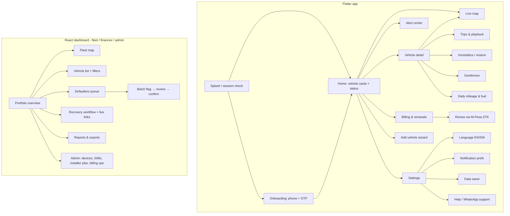
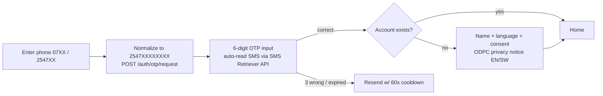
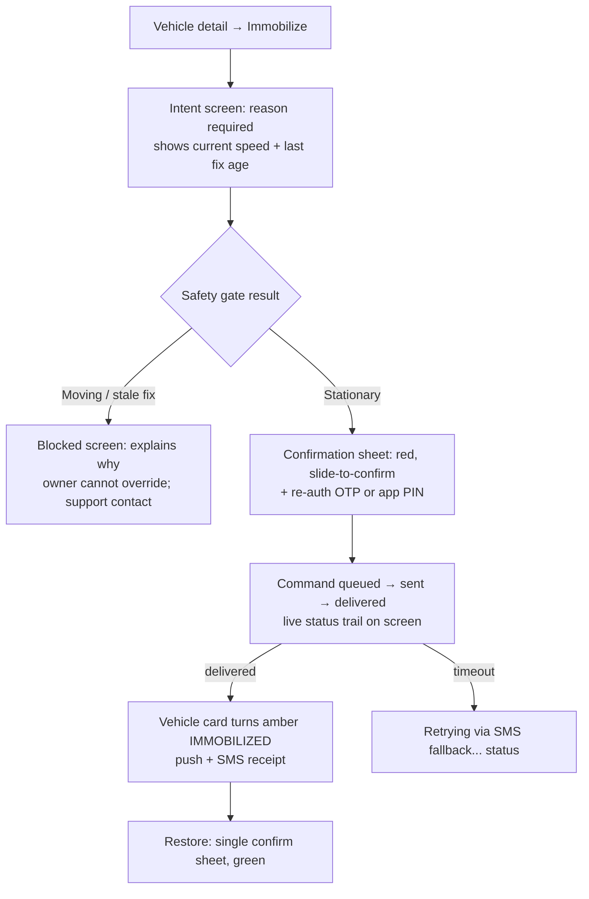

# 03 — App Design & Prototype Spec

Flutter mobile app (Android-first, EN/SW) and React web dashboard for the platform specified in [01-technical-spec.md](01-technical-spec.md). The mobile app is the product for owners and riders; the web dashboard serves fleet managers, financier ops, and internal admin. This document specifies the mobile app in full and the financier console at flow level.

---

## 1. Personas

| Persona | Profile | Device & context | Top jobs-to-be-done | Design consequences |
|---|---|---|---|---|
| **Wanjiku — individual car owner** | 38, Nairobi, runs a shop; car is her biggest asset | Mid-range Android (3–4 GB), M-Pesa daily user, English UI but Swahili comfort | "Is my car where it should be?"; instant alarm if towed/started at night; renew without calling anyone | One-glance home screen; loud critical alerts; STK renewal in 2 taps |
| **Otieno — boda boda rider** | 26, Kisumu, bike on loan from a financier | 1–2 GB RAM Android Go, limited data bundles, Swahili-first | Bike recovery if stolen (livelihood); prove location history in disputes; know when renewal is due | Swahili default, data-saver mode, tiny APK, works on spotty 3G; renewal price transparency |
| **Grace — fleet manager** | 44, manages 32 delivery vans + matatu SACCO liaison | Laptop (web dashboard) + Android | Where is everyone now; overspeed/restricted-hours discipline; mileage & fuel reports for month-end | Dashboard list+map, exportable reports, driver-behavior summaries |
| **Kiprop — financier ops agent** | 31, works at an asset financier's collections desk | Web dashboard all day, Android in the field | Flag defaulters per policy, confirm immobilizations safely, run recoveries with agents/police | Portfolio views, batch ops with per-unit safety verdicts, shareable recovery links, everything audited |

---

## 2. Information architecture



**Mobile navigation:** bottom bar with 4 tabs — **Home · Map · Alerts · More** (billing lives on Home as a card + in More; deep-linked from renewal push). Vehicle detail is pushed on top. Single-vehicle users (most bodas) land on their vehicle's detail directly.

---

## 3. User flows

### 3.1 Onboarding — phone + OTP



Edge states: no SIM in phone (manual entry ok), SMS delayed (resend after 60 s countdown), airplane mode (offline error with retry).

### 3.2 Add vehicle

Two branches after "Add vehicle" (plate, type, make):

- **Installer-assisted (default):** user books a slot → backend creates `installer_job` → installer app-side checklist (fit device, wire relay, run cut/restore test, photo + geotag) → device auto-links when the pre-registered IMEI comes online → user gets "Vehicle live" push. User never types an IMEI.
- **Self-serve (device already fitted / migrating from incumbent):** user enters IMEI from sticker → backend validates against pre-registered stock or accepts a migration IMEI → shows live "waiting for first report" screen with SIM/data checklist if silent > 5 min.

### 3.3 Live map

Open map → last-known position renders **instantly from cache** (with age label "as at 14:02") → WebSocket subscribes → marker animates on updates ≤ 10 s. Status chip: Moving (speed) / Parked (duration) / Engine on / Offline (last seen). Data-saver: updates every 30 s, no map rotation animations.

### 3.4 Trip playback

Trips tab → day picker → trip list (start → end, km, minutes, max speed) → tap trip → polyline drawn with start/stop pins → play button animates a marker with a scrubber; speed shown along route (color-coded segments ≥ 90 days history per parity requirement).

### 3.5 Immobilize / restore (two-step, mirrors backend §5 of doc 01)



### 3.6 Alert center

Chronological inbox grouped by day; filter chips (Critical / Movement / Geofence / Power / Billing). Tap → detail with mini-map of position snapshot + "View on map" + Acknowledge. Critical alerts (power cut, jamming) use a distinct full-screen heads-up notification with alarm sound, bypassing quiet hours.

### 3.7 Renew via STK Push

Renewal card (Home) or push notification → invoice screen: plan, period, **price shown plainly** (transparent-pricing differentiator) → "Lipa na M-Pesa" → STK push fired to registered phone → in-app "Check your phone" state with 90 s spinner → callback confirms → success screen + SMS receipt with new expiry. Fallback path on same screen: "Pay via PayBill: Business No. XXXXXX, Account: KDA123A" with copy buttons; C2B reconciliation activates the moment payment lands.

### 3.8 Financier console (web)

- **Portfolio view:** cards — units total / online % / arrears buckets (1–7, 8–30, 30+ days) / immobilized / in recovery. Table with search, saved filters, CSV export.
- **Defaulters queue:** rows auto-flagged by policy (e.g., ≥ 14 days arrears) via LMS webhook/import. Each row shows repayment status, last position age, **safety verdict** (Stationary ✓ / Moving ✗ / Offline —).
- **Batch immobilize:** select rows → review screen re-runs safety checks per unit → ops agent confirms with password + reason → per-unit result trail (sent/delivered/failed/blocked). Blocked units stay queued and auto-prompt when they become stationary. Every action lands in the audit log with the agent's name.
- **Recovery:** vehicle → "Start recovery" → creates case + **shareable live-location link** (expiring, revocable) for police/recovery agents — opens in any browser, no login, shows live marker + phone-friendly directions button. Case closes with outcome (recovered / written off) feeding recovery-stats reports for insurers.

---

## 4. Screen-by-screen specs (mobile)

Conventions for all screens: **Loading** = skeleton placeholders (never blank spinners); **Empty** = illustration + one-line explanation + primary action; **Error** = friendly message + retry, never a stack trace; **Offline** = banner "Offline — showing last known data" with cached content still usable.

### 4.1 Home

```
┌──────────────────────────────┐
│ FleetView        🔔(2)   ☰   │
├──────────────────────────────┤
│ ⚠ Renewal due in 3 days      │  ← dismissible billing banner
│   KDA 123A · KSh 2,500  [Lipa]│
├──────────────────────────────┤
│ ┌──────────────────────────┐ │
│ │ 🏍 KMFB 421C   ● Moving  │ │  ← vehicle card
│ │ Tom Mboya St, Kisumu     │ │
│ │ 34 km/h · updated 8s ago │ │
│ │ [Map] [Trips] [⚡Engine] │ │
│ └──────────────────────────┘ │
│ ┌──────────────────────────┐ │
│ │ 🚗 KDA 123A    ◌ Parked  │ │
│ │ Home geofence · 2h 14m   │ │
│ │ Battery 12.4V · OK       │ │
│ └──────────────────────────┘ │
│ [+ Add vehicle]              │
├──────────────────────────────┤
│  🏠Home   🗺Map   🔔Alerts  ⋯ │
└──────────────────────────────┘
```

States — Empty: "No vehicles yet" + Add vehicle CTA + "Book an installer" link. Offline: cards show cached data with age labels. Error: pull-to-refresh retry.

### 4.2 Live map

```
┌──────────────────────────────┐
│ ← KMFB 421C        ⛶  ⚙      │
│ ┌──────────────────────────┐ │
│ │        ▲ (marker,        │ │
│ │         heading arrow)   │ │
│ │   ····· recent trail     │ │
│ │                          │ │
│ │              [◎ recenter]│ │
│ └──────────────────────────┘ │
│ ● Moving · 34 km/h · NE      │
│ Ignition ON · GSM ▂▄▆ · 8s   │
│ ┌────────┬────────┬────────┐ │
│ │ Trips  │Geofence│ ⚡Engine│ │
│ └────────┴────────┴────────┘ │
└──────────────────────────────┘
```

Loading: cached last position immediately + shimmer on status bar. Offline device: grey marker, "Last seen 09:14, Kondele" + prominent [Alert me when back online] toggle.

### 4.3 Immobilize confirmation (step 2)

```
┌──────────────────────────────┐
│        ⚠ CUT ENGINE?         │
│  KMFB 421C — Kondele, Kisumu │
│  Status: ◌ Stationary 12 min │
│  Safety check: ✓ PASSED      │
│                              │
│  Reason: [Theft suspected ▾] │
│                              │
│  Enter your PIN: [_ _ _ _]   │
│                              │
│  ⟦  SLIDE TO CUT ENGINE  ≫ ⟧ │
│                              │
│         [Cancel]             │
└──────────────────────────────┘
```

Blocked variant replaces the slider with: "🚫 Vehicle is moving at 47 km/h. For safety, engine cut is disabled while moving. We'll notify you when it stops." + [Notify me] + support link.

### 4.4 Trips & playback

List: day header → trip rows (`07:14 → 07:52 · 18.4 km · max 62 km/h`). Playback: full map, polyline, ▶︎ with 1×/4×/16×, scrubber, distance/time HUD. Empty day: "No trips on this day". Loading: skeleton rows. 90+ days selectable via calendar.

### 4.5 Alert center

Rows: icon + title + vehicle + time + unread dot; critical rows tinted red. Detail: mini-map snapshot, message EN/SW, [View live] [Acknowledge]. Empty: "All quiet ✅". Notification-permission revoked: persistent banner prompting re-enable.

### 4.6 Billing & renewal

Subscription card per vehicle: plan name, expiry date, state pill (Active / Grace / Suspended), price **always visible**. Pay screen per §3.7 with STK primary + PayBill fallback. History list of receipts (M-Pesa ref, date, amount) — receipts shareable as text. Error (STK timeout): "We didn't get confirmation. If you entered your PIN, your receipt will arrive by SMS — don't pay twice." + [Check again].

### 4.7 Settings (More)

Language toggle EN/SW (instant, no restart) · Notification preferences matrix (per alert type: Push / SMS / Off) · Quiet hours · Data saver (on/off/auto on metered) · PIN setup for immobilization · Privacy & consent (ODPC notice, data export/delete request) · Help: WhatsApp deep link + FAQ · About/version.

---

## 5. Design system

**Palette (high-contrast, outdoor-readable, AA on all pairs):**

| Token | Hex | Use |
|---|---|---|
| `ink` | `#0B1D26` | Text, dark surfaces |
| `paper` | `#FFFFFF` | Backgrounds |
| `primary` | `#0E7C3A` | Brand green — actions, active states (Kenyan green, M-Pesa adjacency) |
| `primary-dark` | `#0A5C2B` | Pressed states, dark accents |
| `signal-red` | `#C62828` | Critical alerts, immobilize |
| `amber` | `#F9A825` | Warnings, grace states, immobilized status |
| `sky` | `#1565C0` | Links, info, trip polylines |
| `grey-1/2/3` | `#F4F6F7 / #C7D0D4 / #6B7A80` | Surfaces, borders, secondary text |

**Typography:** Inter (or system Roboto to save APK size — final call at build) — 22/28 bold headings, 16/24 body, 13/18 captions; numerals tabular in speed/price displays. Minimum body size 14 sp; critical statuses ≥ 16 sp bold. **Iconography:** Material Symbols (rounded), filled variants for states, consistent 24 dp; vehicle-type glyphs (car/bike/tuktuk/truck) used as map markers with heading arrow. **Map styling:** light grey basemap (OSM-based tiles), high-contrast roads, brand-green marker for own vehicles, red pulsing marker in recovery mode; night mode inverts to dark basemap.

**Bilingual copy — the 10 most important strings:**

| # | Context | English | Kiswahili |
|---|---|---|---|
| 1 | Status chip | Moving · 34 km/h | Inatembea · 34 km/h |
| 2 | Status chip | Parked · 2 h 14 min | Imeegeshwa · saa 2 dak 14 |
| 3 | Critical alert | ⚠ Power disconnected! Last seen: Tom Mboya St, 14:02 | ⚠ Umeme umekatwa! Ilionekana mwisho: Tom Mboya St, 14:02 |
| 4 | Critical alert | Possible GPS jamming detected near {place} | Huenda GPS inazuiliwa karibu na {place} |
| 5 | Immobilize CTA | Cut engine (vehicle must be stationary) | Zima injini (gari lazima liwe limesimama) |
| 6 | Immobilize done | Engine cut confirmed at {time}. Restore anytime. | Injini imezimwa saa {time}. Unaweza kuiwasha tena wakati wowote. |
| 7 | Renewal | Your tracking expires in {n} days. Renew for KSh {amount}. | Huduma yako itaisha baada ya siku {n}. Lipia KSh {amount}. |
| 8 | STK prompt | Check your phone and enter your M-Pesa PIN | Angalia simu yako na uweke PIN yako ya M-Pesa |
| 9 | Receipt SMS | Payment received: KSh {amount}, ref {ref}. Valid till {date}. Asante! | Malipo yamepokelewa: KSh {amount}, kumb. {ref}. Halali hadi {date}. Asante! |
| 10 | Offline banner | Offline — showing last known location ({time}) | Hakuna mtandao — inaonyesha mahali pa mwisho ({time}) |

Tone: plain, respectful, zero jargon; Swahili reviewed by a native speaker before release (Sheng-adjacent phrasing tested with boda focus group, but UI stays standard Kiswahili).

---

## 6. Android-first engineering constraints

| Constraint | Approach |
|---|---|
| APK size ≤ 25 MB | Flutter with `--split-per-abi`, deferred map assets, system fonts fallback, no heavyweight SDKs |
| 1–2 GB RAM devices | One map instance app-wide (reused across screens), list virtualization, image-free UI (vector icons), cap cached tiles at 50 MB LRU |
| Low data | `X-Data-Saver` header (server thins payloads, §4.2 of doc 01), WebSocket → 30 s polling fallback on metered/weak networks, gzip everywhere, no auto-playing anything |
| Offline caching | Drift (SQLite): last positions, 7 days of trips, alert inbox; map tile cache; all screens render from cache first, then refresh |
| Battery | No client-side background GPS at all (the tracker is the tracker — app is purely a viewer); FCM for wake-ups |
| Reliability | Crash reporting (Sentry) gated by consent; offline action queue with retry |
| Min SDK | Android 7.0 (API 24) — covers Android Go fleet in market |

---

## 7. Prototype

A clickable static HTML/CSS mockup of key screens ships in [prototype/](prototype/index.html) (no build tooling — open `index.html` in any browser): Home, Live map, Immobilize confirm, Alerts, Renewal/STK, and the Financier console. It demonstrates palette, typography, states, and the EN/SW toggle on the ten core strings.

## 8. Assumptions

1. Brand name placeholder **"FleetView"** used in mockups; final name pending trademark/domain check (business plan §GTM).
2. Map tiles: OpenStreetMap-based provider with offline-cache-friendly licensing for v1 (Mapbox/Google as paid upgrade if tile quality complaints arise).
3. Immobilize re-auth uses an app PIN (set once) rather than OTP-per-action, balancing safety with cost of OTP SMS; financier console uses password + reason instead.
4. iOS app deferred to post-M3 (Android is ~95 % of target market); dashboard is responsive as the stopgap for iPhone-owning fleet managers.
5. WhatsApp support link (not in-app chat) for v1 support.
